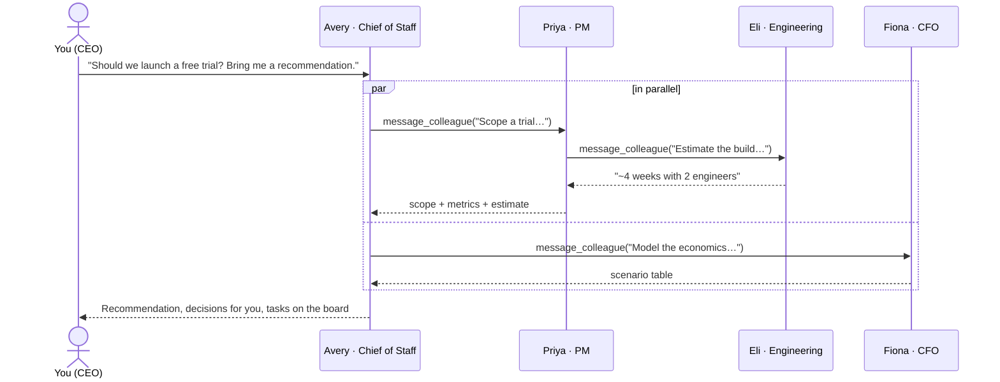
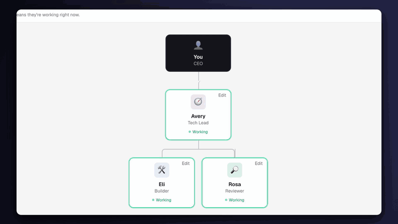

# AgentStaff · manage an AI team like an org chart

*An AI agent management app, built in Claude Code.*

*Original project, started in October 2026 by [Madhuri Siddulagari](https://github.com/madhurismba-dev). This repository is its only official home.*

**Chat with your AI chief of staff, product manager, engineer and CFO in parallel, and watch them work with each other.**

AgentStaff is a workspace laid out like Slack, where every employee is an AI agent. You're the CEO. Pick anyone in the
left nav and start a conversation. Ask your CFO about runway while your product manager writes a PRD. Hand your
chief of staff a goal and watch them delegate it: they message the PM, the CFO and marketing **at the same time**,
the PM pulls in the engineer for an estimate, tasks land on a shared board, and you get one recommendation back.

Every agent-to-agent conversation is its own thread you can open and read. Nothing happens in a black box.


> **Try it without an API key:** the app opens with a sample workspace that replays a full session.

---

## Why I built this

Most "AI agent" demos are a single chat box. Real companies don't work like that: work moves between people,
in parallel, through handoffs, with a chief of staff keeping it all on track. I wanted to see what an
**org chart of AI agents** feels like to manage, using the same mental model as running a team:

- **You talk to people, not prompts.** Each agent has a name, a role, a manager and a mission.
- **Work happens in parallel.** Each conversation is an independent Claude session, like several Claude Code
  sessions open side by side.
- **Delegation is visible.** When an agent asks a colleague for help, a new thread appears in the sidebar
  and streams live.
- **Accountability is built in.** Agents put work on a shared task board and keep it current.

## Features

| | |
|---|---|
| 💬 **Parallel chats** | Message any agent. Several agents can be working at once; the sidebar shows who's busy. |
| 🤝 **Agents talk to each other** | Agents use a `message_colleague` tool to delegate or ask for input. Several requests in one turn run concurrently. |
| 🏢 **Live org chart** | See who reports to whom and who's working right now. Click anyone to chat. |
| 📋 **Shared task board** | Agents create and update tasks; you can move them too. |
| 🧑‍💼 **Hire your own agents** | Add, edit or remove agents: name, title, mission, manager, web access. Three starter teams included. |
| 🔎 **Web research** | Agents you allow can search the web (Claude's server-side web search tool). |
| 💸 **Cost meter** | Estimated spend for the workspace, from real token usage at list prices. |
| 🔒 **No backend** | Static site. Your API key stays in your browser and goes only to Anthropic. |
| 🖥️ **Local mode (v2, optional)** | Each agent is a real Claude Agent SDK session working in its own folder on your machine. [More below](#local-mode-v2). |
| 🎬 **Demo mode** | A scripted replay of a full session so anyone can see it work with no key. |

## Screenshots

| Org chart | Agents talking to each other | Task board |
|---|---|---|
|  |  |  |

## How it works



**Every thread is its own Claude conversation.** A DM is you ↔ one agent. A team thread is agent ↔ agent; it's
created the first time one agent messages another and continues on later requests, so agents remember earlier
exchanges with each colleague.

**Delegation is a tool call.** Each agent gets these tools:

| Tool | What it does |
|---|---|
| `message_colleague(to, message)` | Opens or continues the team thread, runs the colleague's turn there, and returns their reply as the tool result. |
| `create_task` / `update_task` / `view_task_board` | Read and write the shared task board. |
| `web_search` (optional) | Claude's server-side web search, for agents you allow. |

When a model response contains several `message_colleague` calls, the engine runs them **concurrently**
(`Promise.all`) and returns all results in one message. That's what makes the team feel parallel.

**Guardrails against runaway agents**

- **Budget per request:** every message you send gets a spending cap ($1 by default, set in Settings). It covers
  everything the request sets off; when it's reached, all of its sub-conversations stop at once.
- **Delegation follows the org chart:** the agent you're talking to can reach the whole team; everyone else can
  only delegate to their own direct reports.
- **Depth limit and no loops:** at most You → agent → colleague → colleague, and an agent can't message itself or
  anyone above it in the current chain (the `to` field is a strict enum that excludes them).
- **No duplicate busywork:** agents must check the task board, duplicate titles are rejected, and each request can
  create at most 6 tasks.
- **Turn limit:** at most 8 tool rounds per turn.
- **One turn at a time per thread:** each thread is serialized with a lock; different threads run in parallel.
- **Stop button:** aborts a conversation and every delegated sub-conversation under it, and leaves the history valid.

### What the first live run taught me

I gave the team a real problem: *"Churn jumped from 3% to 5% a month. Diagnose it and bring me a 30-day plan."*
The first version had no budget and let any agent message any other. The agents were genuinely useful: the CFO
modeled the ARR impact (about $307K a year), and the chief of staff correctly escalated what only the CEO could
decide (data access, how churn is defined). But they **over-collaborated**: 18 agent-to-agent threads, 29 tasks
with many duplicates, and about $4.50 of API spend before I stopped it.

That's the same failure mode human orgs have, just faster. The fixes mirror how a good chief of staff runs a
team: a budget per initiative, delegation through reporting lines, and one shared source of truth for tasks.

Then I attacked cost directly. Two-thirds of the bill was **input** tokens: every tool round re-sends the whole
conversation. Prompt caching makes those re-reads ~90-95% cheaper, and an Economy mode runs the team on Claude
Haiku 5.5. Same goal, rerun:

| | First run | After the fixes (Economy mode) |
|---|---|---|
| Cost | $4.53 | **$0.013** |
| API calls | 81 | 19 |
| Agent-to-agent threads | 24 | 4 |
| Tasks created | 37 | 4 |
| Input served from cache | 0% | 53% |
| Final recommendation | not reached | delivered: ranked 30-day plan, revenue scenarios, decisions |

Most of the ~350x comes from the model switch; the guardrails and caching alone cut the same workload by roughly
10x on any model (estimated from token counts). Balanced and Best modes cost more and go deeper.

**Built on the Claude API**

- Three cost modes: **Economy** (Claude Haiku 5.5), **Balanced** (Claude Sonnet 5.5, the default) and **Best**
  (Claude Opus 5.5), each with a matching effort level and per-request budget.
- Prompt caching: an explicit cache breakpoint on the static prefix (tools + system prompt) plus automatic caching
  of the growing conversation, so repeated history is billed at 5-10% of the normal input price.
- Streaming responses, so you watch every agent type.
- Strict tool schemas, with inputs validated by [Zod](https://zod.dev) before anything runs.
- Server-side refusal fallback (`fallbacks: "default"`) enabled on supported models.
- Conversation history is append-only and replayed exactly as received, which preserves thinking blocks between turns.
- `pause_turn` (long web searches) and `max_tokens` stops are handled explicitly.

### Architecture

```
src/
├─ app/page.tsx              Layout: sidebar + current view, settings and hire dialogs
├─ lib/engine.ts             The agent runtime: turns, tools, parallel delegation, guardrails, cost
├─ lib/store.ts              Workspace state (threads, tasks, org, usage) + localStorage persistence
├─ lib/templates.ts          Starter teams: Startup, Product squad, Personal board of directors
├─ lib/demo.ts               Scripted sample session for demo mode
├─ components/Sidebar.tsx    Team list with live status, agent conversations, cost meter
├─ components/ThreadView.tsx Chat UI with streaming markdown and linked activity notes
├─ components/OrgChart.tsx   Org chart tree with live status
├─ components/TaskBoard.tsx  Kanban board
├─ lib/local/protocol.ts     Local mode: WebSocket messages shared by browser and server
├─ lib/local/client.ts       Local mode: connects to the server and mirrors its events into the store
server/                      Local mode (v2), Node only
├─ cli.ts                    `agentstaff local`: build if needed, start, print the link, open the browser
├─ server.ts                 Static UI + WebSocket on 127.0.0.1, token/Origin/Host checks
├─ runtime.ts                One Agent SDK session per thread: hooks, canUseTool, approvals, streaming, cost
├─ permissions.ts            Roles, path containment, the allow/ask/deny policy
├─ handoff.ts                Hand-off routing, return format, turn caps
├─ notes.ts / sessions.ts    Shared notes and saved session IDs (JSON, owner-only)
├─ snapshot.ts / config.ts   Folder snapshots; folders, auth detection, environment
└─ plugins.ts                Extension points
tests/
├─ engine.test.ts            Browser engine: full multi-agent scenario against a fake API (no network, no cost)
├─ local-*.test.ts           Local mode: permissions, hand-offs, sessions, server security (fake SDK, no network)
└─ fake-sdk.ts               A scripted stand-in for the Agent SDK
```

The engine updates a small external store from outside React (many agents stream at once), and components
subscribe with `useSyncExternalStore`.

## Local mode (v2)

Browser mode is a team that talks. Local mode is a team that can also **work on files**. Run a small Node server
on your machine and each agent becomes its own [Claude Agent SDK](https://code.claude.com/docs/en/agent-sdk/overview)
session (the same agent loop and tools as Claude Code), working in its own folder. The UI is the same: DMs,
agent-to-agent threads, the org chart and the cost meter all work as before, and tool calls show up inline.



Browser mode is unchanged. The hosted static site never talks to a local server; local mode turns on only when
you open the link the server prints.

### Setup

You need Node.js 22+ and an Anthropic API key in your environment:

```bash
export ANTHROPIC_API_KEY=sk-ant-...      # or set it however you manage secrets
npm install
npm run local                            # or: npx agentstaff local
```

The first run builds the UI (`next build`), then the terminal prints a link like
`http://127.0.0.1:4317/#token=…` and opens it. Run `npm run local -- --rebuild` after pulling changes.

| Flag | What it does |
|---|---|
| `--port 4317` | Port on 127.0.0.1 |
| `--root ~/AgentStaff` | Parent of the agent folders |
| `--no-open` | Don't open the browser |
| `--allow-origin http://localhost:3000` | Also accept the `next dev` UI (open the "Dev UI" link it prints) |
| `--plugin ./my-plugin.ts` | Load a plugin (see [Extension points](#extension-points)) |

### What each agent gets

- **Its own folder**, `~/AgentStaff/<agent id>` by default (change it per agent under **Edit → Local mode**). On its
  first turn after launch, the agent gets a snapshot of that folder (a short file tree) in its context.
- **Hand-offs** through `message_colleague`, now an in-process MCP tool. A hand-off states the task, **what to send
  back** (`return_format`) and a **turn cap** (`max_turns`, default 12, max 40). The same routing rules as browser
  mode apply: the agent you talk to can reach everyone, others only their direct reports, at most two levels deep.
  Several hand-offs in one turn are meant to run in parallel.
- **Shared notes**, named notes any agent can `write_note` / `read_note` / `list_notes`. A hand-off passes notes
  **by name**, so a long spec isn't pasted into every prompt. (Idea from
  [multi-agent-coding-system](https://github.com/Danau5tin/multi-agent-coding-system)'s context store; no code taken.)
- **Resumable sessions.** Session IDs are saved per agent and thread in `~/AgentStaff/.agentstaff/sessions.json`,
  so after a restart each conversation resumes where it left off. If a session can't be resumed, the agent says
  so and starts fresh. Starting a new workspace in Settings clears them.
- **A role** that sets its tools:

  | Role | Tools |
  |---|---|
  | Builder (default) | Read, Glob, Grep, Write, Edit, NotebookEdit run on their own inside the folder. Bash asks you first. |
  | Reviewer (read-only) | Read, Glob, Grep. No writes, no shell. |

  Agents with web access also get WebSearch (runs) and WebFetch (asks), if web search is allowed in Settings.
- **Always ask**, a per-agent switch: every tool use appears in the thread as a card with **Approve / Deny**. The
  sidebar shows how many are waiting.
- **Verify after change**: after each file edit, the agent is told to re-read what it changed and run the folder's
  tests or build (if its role allows) before reporting done. On by default; per-agent switch.

Model, effort and the budget per request from Settings apply here too. Cost comes from the SDK's own per-run total.

### Security model

The server can make agents run tools on your machine, so it's locked down:

- **127.0.0.1 only.** The bind address isn't configurable.
- **A random token per launch** (32 bytes), printed in the terminal and passed in the URL fragment (`#token=…`, which
  browsers don't send to servers). The page moves it to session storage and removes it from the address bar. The
  WebSocket sends it as a subprotocol; tokens are compared in constant time.
- **Origin and Host checks** on every WebSocket connection: only the UI the server serves (plus any
  `--allow-origin`) can connect, and the Host header must be 127.0.0.1 or localhost on our port (DNS-rebinding
  protection).
- **Every tool call goes through a policy check** in a `PreToolUse` hook (which runs before Claude Code's own allow
  rules) and again in `canUseTool`. File tools must resolve inside the agent's folder: `..`, `~`, absolute paths and
  symlinks (including dangling ones) are resolved before comparing, and anything outside is denied, even with
  Always ask on. Tools outside the agent's role are denied and hidden from the model.
- **Isolation from your own Claude Code setup:** `settingSources: []`, so `~/.claude` settings, allow rules and
  CLAUDE.md files aren't loaded, and only AgentStaff's own MCP server is attached (`strictMcpConfig`).
- **Keys stay in the server's environment.** The API key is never sent to the browser, written to disk or logged;
  log lines are scrubbed for `sk-ant-…` strings and the token. State files are written owner-only (0600).
- **Plugins can only tighten.** A plugin's permission check can deny or ask, never allow something the core denied.

### Authentication

Local mode uses API-key auth only, read from the environment of the terminal you start it in. It doesn't offer
claude.ai login and won't use one. The Agent SDK quickstart
([code.claude.com/docs/en/agent-sdk/quickstart](https://code.claude.com/docs/en/agent-sdk/quickstart), checked
2026-10-21) says:

> Unless previously approved, Anthropic does not allow third party developers to offer claude.ai login or rate
> limits for their products, including agents built on the Claude Agent SDK. Use the API key authentication methods
> described in this document instead.

The supported methods on that page are `ANTHROPIC_API_KEY` (a key from the
[Claude Console](https://platform.claude.com/)), or a cloud provider: Amazon Bedrock (`CLAUDE_CODE_USE_BEDROCK=1`),
Claude Platform on AWS (`CLAUDE_CODE_USE_ANTHROPIC_AWS=1`), Google Cloud (`CLAUDE_CODE_USE_VERTEX=1`) or Microsoft
Foundry (`CLAUDE_CODE_USE_FOUNDRY=1`), each with that provider's credentials. AgentStaff accepts any of these. To
make sure a claude.ai login on your machine is never picked up, it removes `CLAUDE_CODE_OAUTH_TOKEN` from the
agents' environment, doesn't load your Claude Code settings, and stops a session whose init message reports no API
key while you're in API-key mode. Use of the Agent SDK is governed by
[Anthropic's Commercial Terms of Service](https://www.anthropic.com/legal/commercial-terms).

### Limitations

- **Shell commands can't be contained.** Bash asks for approval because a command can touch any path; the folder
  check covers the file tools only. Read the command before you approve it.
- **Path checks happen before the tool runs.** A process that swaps a file for a symlink between the check and the
  write could get around it; hard links aren't detected. This guards against agent mistakes, not a hostile local user.
- **The task board isn't connected to local agents yet.** They use shared notes instead.
- **Streaming is per connection.** Reload during a run and you'll see busy agents and pending approvals, but not
  the text already streamed for the current reply.
- **Parallel hand-offs** depend on Claude Code running concurrent MCP calls; `message_colleague` is marked
  read-only for that reason (it doesn't touch the caller's folder). In a live run on Claude Haiku, a lead's two
  hand-offs (builder and reviewer) ran at the same time.
- It runs on your machine with your key and your files. It's a builder's tool, not a sandbox or a hosted service.

### Extension points

`server/plugins.ts` defines a small plugin interface, so features can be added without editing core files. A
plugin is a module whose default export is an object (or an array of them):

| Hook | Use it to |
|---|---|
| `roles` | Add roles with their own tool sets |
| `tools(turn, sdk)` | Give agents extra in-process MCP tools |
| `beforeTurn(turn)` | Override model, effort, turn cap or system prompt for a turn |
| `checkTool(request)` | Add stricter permission rules (deny or ask) |
| `onEvent(event)` | Watch the event stream (messages, tool notes, cost, approvals) |
| `setup(api)` | Run code at startup with `sendFromCeo`, `stop` and `org` |

```ts
// my-plugin.ts → npm run local -- --plugin ./my-plugin.ts
export default {
  name: "docs-writer",
  roles: { writer: { label: "Writer", description: "Edits docs only", tools: { Read: "auto", Glob: "auto", Write: "ask", Edit: "ask" } } },
};
```

## Privacy and cost

- **In browser mode there is no AgentStaff server.** The app is a static site. Your Anthropic API key is saved in your browser's
  local storage and sent only to `api.anthropic.com`. Conversations are stored only in your browser.
- Calling the API directly from a browser requires the SDK's `dangerouslyAllowBrowser` flag. That's appropriate
  here because it's **your own key on your own device**. Don't deploy AgentStaff with a shared key baked in.
- You pay Anthropic directly for usage. The sidebar shows an estimate and how much input came from the cache.
  Delegation multiplies calls, so a goal handed to the chief of staff costs more than a single chat. Every request
  has a hard budget (Settings), and Economy mode runs a full team request for about a cent.

## Getting started

You need Node.js 20+ and an Anthropic API key ([get one here](https://platform.claude.com/settings/keys)).

```bash
git clone https://github.com/madhurismba-dev/agentstaff.git
cd agentstaff
npm install
npm run dev
```

Open http://localhost:3000. The sample workspace plays first. Click **Start your own workspace**, paste your API key,
pick a team, and start chatting.

**Try these**

- To Avery (Chief of Staff): *"We're considering a 14-day free trial for our B2B product. Get the team on it and
  bring me a recommendation."*
- To Fiona (CFO), at the same time: *"We have $2.1M in the bank and burn $180K a month. What's our runway?"*
- Then open **Agent conversations** in the sidebar and watch the team work.

### Scripts

| Command | What it does |
|---|---|
| `npm run dev` | Local development server |
| `npm run build` | Static production build in `out/` (deploy anywhere: Netlify, Vercel, GitHub Pages) |
| `npm run local` | Local mode (v2): start the local server and open the UI |
| `npm test` | Engine and local-mode tests against fakes (no API calls) |
| `npm run lint` | ESLint |

## Roadmap ideas

- Shared documents agents can co-edit (PRDs, models) alongside chat
- Scheduled "standups" where the chief of staff collects updates on a cadence
- Approval gates: agents ask the CEO before committing to big decisions
- MCP connectors so agents can read your real calendar, docs and metrics
- Export a thread or the whole workspace as a report

## Tech stack

Next.js 16 (static export) · React 19 · TypeScript · Tailwind CSS 4 · Anthropic TypeScript SDK · Zod · react-markdown ·
Claude Agent SDK and `ws` (local mode)

## Author

Built by **Madhuri Siddulagari**, a product leader working on AI, fintech and enterprise SaaS.
Portfolio: [madhuri-pm.netlify.app](https://madhuri-pm.netlify.app)

## License

[MIT](LICENSE)
